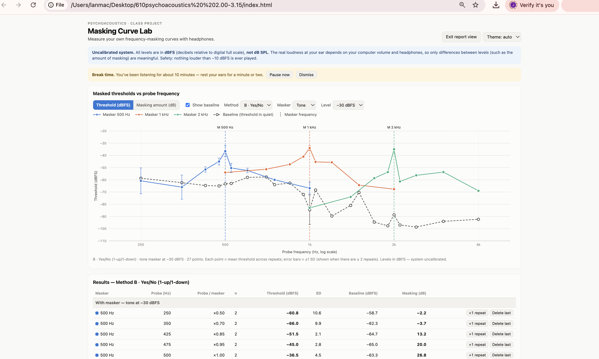
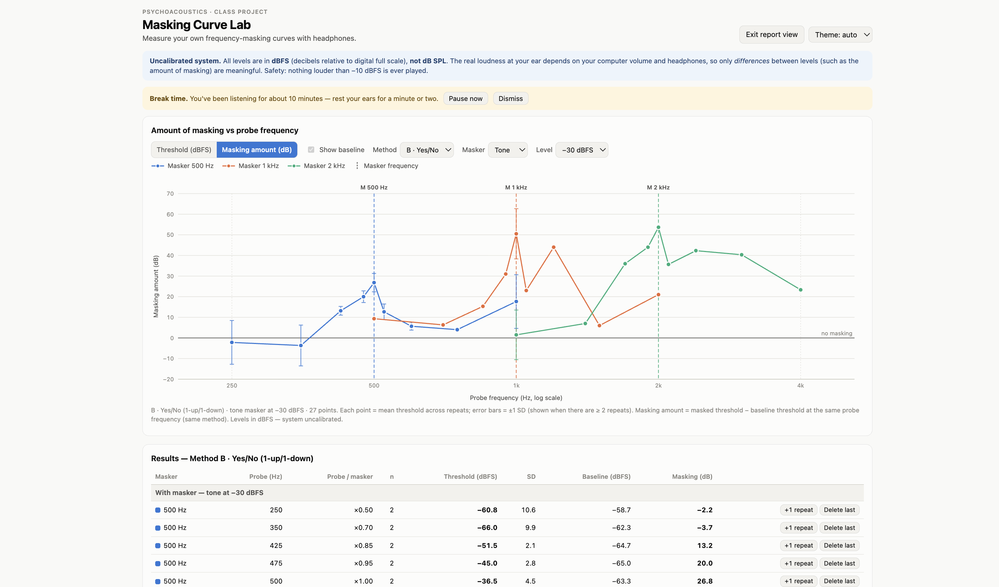
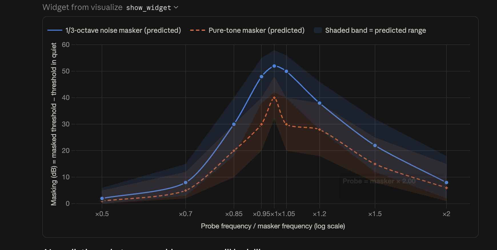

# Frequency Masking Curve Measurement

MUE 610 Psychoacoustics — Masking Curve Lab · **JINGLAN HUANG**

> [!IMPORTANT]
> ## ▶ [Open the web app](https://hhhjinglan-a.github.io/masking-curve-lab/)
>
> **<https://hhhjinglan-a.github.io/masking-curve-lab/>** — runs in any browser, no installation. It opens with my
> measured data already loaded, so the dashboard (masked thresholds, amount of
> masking, results table) is visible straight away; switch the chart between
> *Threshold* and *Masking amount* at the top of the dashboard.
>
> The written report is this page, also as a
> [**PDF**](https://hhhjinglan-a.github.io/masking-curve-lab/downloads/masking_report.pdf).

**Where each deliverable is**

| Deliverable | Where |
|---|---|
| Working web app | [Live app](https://hhhjinglan-a.github.io/masking-curve-lab/); source [`web/index.html`](https://github.com/hhhjinglan-A/masking-curve-lab/blob/main/web/index.html) (single file, no build step) |
| Masking curves for at least three masker frequencies | §2 — 500, 1000 and 2000 Hz, table and Figures 1–2 |
| Screenshot of the final dashboard | §2, Figures 1–2 |
| Short explanation of the measurement method | §1 |
| Discussion: critical-band behavior, masking asymmetry, differences between masker frequencies, experimental limitations | §3.1–3.4 |
| Selected AI prompts and responses | §4 (the pre-measurement prediction is Figure 3) |
| AI suggestions I corrected or rejected | §5 |
| Raw data (every trial and threshold) | [`web/data/masking_data.json`](https://github.com/hhhjinglan-A/masking-curve-lab/blob/main/web/data/masking_data.json) |

---

## 1. Measurement method

Measurements were made over headphones with a self-built web program (Masking Curve Lab: a single HTML file using the Web Audio API). The same signal was played to both ears. The system was not calibrated, so all levels are given in dBFS (relative to digital full scale), not dB SPL. The program's safety limit is −10 dBFS.

- **Masker:** pure tone at 500, 1000 and 2000 Hz, level −30 dBFS, duration 500 ms.
- **Probe:** pure tone, 300 ms, centered within the masker (starting 100 ms after masker onset). Every sound had 20 ms raised-cosine onset and offset ramps to avoid clicks.
- **Probe frequencies:** masker frequency × 0.5, 0.7, 0.85, 0.95, 1.0, 1.05, 1.2, 1.5 and 2.0 (9 points).
- **Threshold in quiet (baseline):** measured at the same probe frequencies with the masker off. Amount of masking = masked threshold − threshold in quiet.
- **Method B (yes/no adaptive staircase):** the probe started at −20 dBFS. A “heard” response lowered the level and a “not heard” response raised it (1-up/1-down). The step size was 6 dB until the first 2 reversals and 2 dB afterwards. Each track stopped after 8 reversals, and the threshold was the mean of the last 6 reversal levels. About 10% of trials were catch trials (masker only, no probe), used to record false alarms.
- **Order:** the 9 probe frequencies of each curve were measured in random order.
- **Amount of data:** 65 thresholds in total (37 masked, 28 in quiet), all converged; 1584 staircase trials plus 13 manual trials from Part 1. There were 120 catch trials with 9 false alarms (7.5%).
- **Repeats:** each point in the 500 Hz group was measured twice; in the 1000 Hz group only ×1.0 was measured twice and the rest once; each point in the 2000 Hz group was measured once. For thresholds in quiet, 1000 Hz was measured 4 times, 500 and 2000 Hz twice each, and the rest once.
- **Headphones:** Apple AirPods 4.

## 2. Results

The table below gives the mean masked threshold (dBFS) and the amount of masking (dB) at each point. Pure-tone masker, −30 dBFS, Method B.

| Probe / masker | 500 Hz threshold | 500 Hz masking | 1000 Hz threshold | 1000 Hz masking | 2000 Hz threshold | 2000 Hz masking |
|---|---|---|---|---|---|---|
| ×0.50 | −60.8 | −2.2 | −54.0 | 9.3 | −83.0 | 1.5 |
| ×0.70 | −66.0 | −3.7 | −51.3 | 6.3 | −74.0 | 7.0 |
| ×0.85 | −51.5 | 13.2 | −47.3 | 15.3 | −58.7 | 36.0 |
| ×0.95 | −45.0 | 20.0 | −41.0 | 31.0 | −53.7 | 44.0 |
| ×1.00 | −36.5 | 26.8 | −34.0 | 50.5 | −35.0 | 53.7 |
| ×1.05 | −50.3 | 12.7 | −45.3 | 23.0 | −61.3 | 35.7 |
| ×1.20 | −52.3 | 5.7 | −45.7 | 44.0 | −56.3 | 42.3 |
| ×1.50 | −60.0 | 4.0 | −64.3 | 6.0 | −53.7 | 40.3 |
| ×2.00 | −66.8 | 17.7 | −67.7 | 21.0 | −69.0 | 23.3 |

*Figure 1: Dashboard, threshold view (solid lines: masked thresholds; gray dashed line: thresholds in quiet).*

*Figure 2: Dashboard, masking view (amount of masking = masked threshold − threshold in quiet).*

## 3. Discussion

### 3.1 Critical-band behavior

All three groups show that masking is generally stronger when the probe is close to the masker frequency. For example, on the low-frequency side, masking decreased in all three groups when the probe moved from 0.95 to 0.85 times the masker frequency. This is consistent with the critical-band and auditory-filter concepts from class: sounds close in frequency interfere with each other more easily. However, this experiment used a pure-tone masker, so beats or roughness may also have provided detection cues. These curves therefore cannot be used directly to determine precise auditory filter bandwidths.

### 3.2 Masking asymmetry

In my results, masking was not stronger on the high-frequency side under all conditions. The 2000 Hz group showed this most clearly: masking was 40.3 dB at ×1.5 of the masker frequency but only 7.0 dB at ×0.7, and masking at ×2.0 was also stronger than at ×0.5. In contrast, the 500 Hz group showed stronger masking on the low-frequency side near the masker, for example 13.2 dB at ×0.85 versus 5.7 dB at ×1.2. In the 1000 Hz group the result depended on which points were compared: masking was stronger at ×1.2 than at ×0.85, but weaker at ×1.05 than at ×0.95. These results therefore support the prediction of a stronger upward spread of masking only under some conditions and do not show a consistent asymmetry pattern.

### 3.3 Differences between masker frequencies

The maximum masking was 26.8, 50.5 and 53.7 dB for the 500, 1000 and 2000 Hz groups, with the latter two clearly higher than the 500 Hz group. However, when the probe was at the masker frequency, the masked thresholds of the three groups were very close: −36.5, −34.0 and −35.0 dBFS. The corresponding thresholds in quiet were −63.3, −84.5 and −88.7 dBFS. Because the amount of masking equals the masked threshold minus the threshold in quiet, the differences in peak masking in these data come mainly from differences in the thresholds in quiet. A larger amount of masking alone therefore does not show that a higher-frequency masker itself masks more strongly.

### 3.4 Experimental limitations

This experiment had no sound-pressure calibration, so levels were recorded in dBFS and cannot be interpreted as dB SPL at the ear; comparisons across sessions also depend on the playback settings staying the same. Most points were measured only once, and some repeated measurements varied considerably. For example, with the 500 Hz masker, the two thresholds for the 250 Hz probe differed by 15 dB (SD 10.6 dB), and the four thresholds in quiet at 1000 Hz ranged from −67.0 to −93.3 dBFS, showing limited consistency across repeats; the available records cannot determine the specific cause. Some thresholds in quiet were close to the program's lower limit of −100 dBFS; if the true threshold was below this limit, the calculated masking may be underestimated. In addition, the yes/no method is affected by the listener's response criterion; the false-alarm rate in this experiment was 7.5%. I measured only the pure-tone masker and Method B, so the results cannot be compared directly with a noise masker or the 2IFC method.

## 4. AI prompts and responses (selected)

AI tools used: Claude (Anthropic) for program design, the pre-measurement prediction and the post-measurement comparison; Codex (OpenAI) for organizing the report text and checking the consistency of wording.

### 4.1 Designing and implementing the program (2026-10-01)

**Prompt (excerpt):**

> Build a single-file web app (one index.html with inline CSS + JavaScript, no build step, no external libraries except optionally Chart.js from a CDN) for a psychoacoustics class project: measuring my own frequency masking curves with headphones. … All levels in dBFS (relative level), NOT dB SPL. … Hard safety cap: nothing louder than -10 dBFS ever plays. … Method B — Adaptive staircase (yes/no) … Method C — Two-interval forced choice (2IFC) …

**AI response (summary):** The AI wrote index.html, including a Web Audio sound engine (pure tones, 1/3-octave noise, 20 ms ramps, a −10 dBFS hard limiter), the Method B and C staircases, full-curve measurement in random order, data saving and export, and threshold/masking charts. The AI ran about 1,100 trials with a simulated listener in a browser to check the staircase logic, and noted that it could not listen itself, so I needed to check by ear that the sound was clean.

### 4.2 AI prediction before measurement (2026-10-01, before data collection)

First, ask the AI to predict what your masking curve will look like.

**AI response (main points):**

- Shape: each curve peaks near probe ≈ masker frequency (×1.0); the low-frequency side is steep, with masking falling to about 0–5 dB by ×0.5; the high-frequency side is shallower, with about 5–15 dB still expected at ×2.0 (upward spread of masking). Masking at ×1.2 is predicted to be clearly larger than at ×0.85.
- Predictions independent of calibration (1 kHz masker at −30 dBFS): 1/3-octave noise, probe ×1.0: threshold about −34 to −38 dBFS; pure tone, probe ×1.0: threshold about −48 to −52 dBFS (the two tones add in phase, so only a change of about 1 dB needs to be detected); pure tone, ×0.95/×1.05: about 5–10 dB lower than at ×1.0 (beat cue).
- Tone vs. noise: the noise curve is higher, wider and smoother; the tone curve shows a sharp peak with dips on either side around ×1.0; a small anomaly may appear at ×2.0 (harmonic beats).
- Different masker frequencies: similar shapes on a log-frequency axis; higher-frequency curves slightly narrower in octaves; masking largest at 2–4 kHz and smaller at 500 Hz (thresholds in quiet are usually higher at low frequencies).
- Thresholds in quiet: about −70 to −90 dBFS; if many points sit near the −100 dBFS floor, the volume is too high and masking will be underestimated.
- Methods: 2IFC thresholds expected to be about 2–5 dB lower than yes/no, but the amounts of masking should be similar; SD of repeated measurements about 2–4 dB; false-alarm rate expected below 10%.
- Least certain: absolute masking depends on the volume and the headphones' frequency response; the shape predictions (peak location, steep low side and shallow high side, noise peak higher than tone peak) are more reliable.

*Figure 3: Prediction curve given by the AI before measurement (amount of masking vs. probe-to-masker frequency ratio).*

### 4.3 Comparison with the prediction after measurement (2026-10-03)

My curves are not symmetric, but masking on the high-frequency side is not stronger in all conditions. The specific thresholds predicted by the AI differ a lot from what I measured, and my measurements also vary, which I need to report honestly. …

**AI response (summary):** The AI checked each of my statements against the exported JSON data and confirmed that they were correct: the maximum masking was at the masker frequency in every group, the threshold for the 1000 Hz probe at the masker frequency was −34.0 dBFS, repeated measurements varied, some thresholds in quiet were near the floor, and only the pure-tone masker and Method B were measured. The AI pointed out two things to revise: (1) stronger high-frequency masking appeared clearly only in the 2000 Hz group, while the 500 Hz group showed stronger low-side masking near the masker and the 1000 Hz group was mixed; (2) the 1000 Hz thresholds in quiet differed by about 20–25 dB between sessions, which the AI attributed to possible changes in system volume, headphone fit or ambient noise. The AI also added that thresholds at ×0.95/×1.05 were 7–26 dB lower than at ×1.0, in the predicted direction.

**My revised comparison paragraph:**

My results partly support the AI's prediction. In all three curves the maximum masking occurred at the masker frequency; when the probe was 5% away from the masker (×0.95, ×1.05), thresholds were 7–26 dB lower than at the masker frequency, forming a sharp peak. This agrees with the direction of the AI prediction, but some of the differences exceeded the predicted 5–10 dB range. Stronger masking on the high-frequency side appeared clearly only in the 2000 Hz group (40.3 dB at ×1.5 versus only 7.0 dB at ×0.7); in the 500 Hz group, masking near the masker was actually stronger on the low-frequency side (13.2 dB at ×0.85 versus 5.7 dB at ×1.2); the 1000 Hz group was inconsistent. The AI's specific numerical predictions were also inaccurate. For example, the threshold for a 1000 Hz probe at the masker frequency was predicted to be −48 to −52 dBFS, but my measured mean was −34.0 dBFS (−35.3 and −32.7 in two runs). If the two same-frequency tones in the program add in phase, a −34 dBFS probe added to the −30 dBFS masker corresponds to a level increase of about 4.25 dB in the steady portion. The loudness change may have been one of the detection cues in this experiment, but this does not determine my general loudness-discrimination threshold. The AI assumed that a change of about 1 dB could be detected, which may be one reason the prediction differed from the measurement. In addition, most points were measured only once, and some repeated measurements varied considerably; for example, with the 500 Hz masker, the two thresholds for the 250 Hz probe differed by 15 dB. The four thresholds in quiet at 1000 Hz ranged from −67.0 to −93.3 dBFS, showing limited consistency across repeats. This may be related to attention, response criterion, headphone fit, ambient noise or playback settings; the available records cannot determine the specific cause. Some thresholds in quiet were close to the program's lower limit of −100 dBFS. If the true threshold was below this limit, the program could not measure it accurately, and the amount of masking would be underestimated. Therefore, I cannot attribute all differences to auditory mechanisms. I measured only the pure-tone masker and Method B, so I did not test the predictions for the noise masker or Method C.

### 4.4 Organizing and checking the report text (Codex, 2026-10-03)

**Prompt (summary):** I provided the key points of the discussion and asked Codex to help organize them into paragraphs and to check whether the explanation of the loudness change was consistent throughout the report.

**Codex response (summary):** Codex helped organize the text of three sections (masking asymmetry, differences between masker frequencies, and experimental limitations), and suggested changing “I detected the probe mainly through the loudness change” to “the loudness change may have been one of the detection cues in this experiment,” to avoid presenting a possible detection cue as an established mechanism.

## 5. AI suggestions I modified or rejected

### Example 1: The AI's inference about why the thresholds in quiet differed (modified)

**AI suggestion:** The 1000 Hz thresholds in quiet differed by about 20–25 dB between sessions, while the masked thresholds at the masker frequency hardly changed. The AI considered this consistent with a change in system volume, headphone fit or ambient noise, and suggested writing “this suggests that the system volume, headphone fit or ambient noise may have differed between sessions.”

**My revision:** I did not adopt this attribution and rewrote it as “The four thresholds in quiet at 1000 Hz ranged from −67.0 to −93.3 dBFS, showing limited consistency across repeats. This may be related to attention, response criterion, headphone fit, ambient noise or playback settings; the available records cannot determine the specific cause.”

**Reason:** I did not record the volume and environment for each session, so the data only show limited consistency and cannot establish a cause; attention and response criterion could also produce differences, which the AI's inference did not consider. Similarly, I changed “the differences were larger than predicted” to “some of the differences exceeded the predicted 5–10 dB range,” because two of the six differences were still within the predicted range.

### Example 2: The AI's prediction of the pure-tone threshold at the masker frequency (rejected by the data)

The AI predicted a threshold of −48 to −52 dBFS for a 1000 Hz pure-tone probe at the masker frequency, but my measured mean was −34.0 dBFS, a difference of about 14–18 dB, so I did not adopt this predicted value.

If the two same-frequency tones in the program add in phase, a −34 dBFS probe added to the −30 dBFS masker corresponds to a level increase of about 4.25 dB in the steady portion. This suggests that the loudness change may have been one of the detection cues in this experiment, but it does not determine my general loudness-discrimination threshold.
